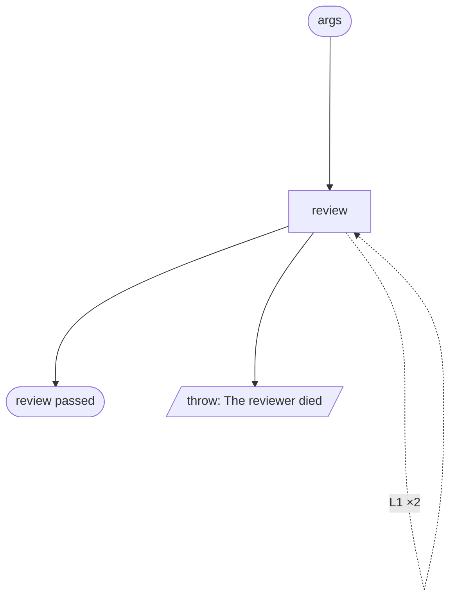

# dynamic-workflow-bundler

Build, validate and simulate dynamic workflow scripts for Claude Code.

A dynamic workflow is one JavaScript file. The Workflow runtime loads no second file, so a large workflow
is one long script, and two workflows cannot share code. This tool removes that limit at build time.

**Status:** in development and not yet on npm. The [roadmap](docs/roadmap.md) lists what is built.

## Commands

| Command | Purpose | Status |
|---|---|---|
| `dwfb build` | Build a workflow script from an entry, its parts, and the modules, text files and JSON files it imports, or every workflow of a config file. | available |
| `dwfb locate` | Find the source file and line that a line of a built script comes from. | available |
| `dwfb validate` | Report each rule of the Workflow runtime that a script breaks, before launch. | available |
| `dwfb simulate` | Run a script against scripted agent returns, with no model call. | available |
| `dwfb inspect` | Show what each agent of a simulation received and returned. | available |
| `dwfb map` | Draw a Mermaid graph of every path that the scenarios of a script reach, with its loops and end states. | available |
| `dwfb snapshot` | Write one copy of each distinct prompt that a script sends per role, so a diff shows which prompts an edit reached, and hold the largest prompt of each role to a prompt budget. | available |
| `dwfb cover` | Report each role, throw site, end state and phase of a script that no scenario reaches. | available |

## dwfb build

The entry is the file that holds `meta` and the top-level body of the workflow. It imports source files by relative paths.

`workflows/review/entry.js`:

```js
export const meta = { name: 'review', description: 'Review a change' };

import { reviewPrompt } from './prompts.js';

return await agent(reviewPrompt(args.change));
```

`workflows/review/prompts.js`:

```js
export function reviewPrompt(change) {
  return `Review this change.
${change}`;
}
```

This command writes the workflow script:

```
dwfb build workflows/review/entry.js --out .claude/workflows/review.js
```

The built script holds the `meta` statement, a banner line, the text files and JSON files, one scope per module and the rest of the entry. Each source line keeps its order, and a JavaScript line outside an import or export statement keeps its text. `--no-banner` leaves out the banner line. `--json` prints the result as one JSON object. When a write fails, the command prints no JSON object, and its message names each script that it wrote before the failure.

The command replaces an existing file at `out` only when the file is a built script. A built script holds a banner line. For a build with no banner, a file whose first statement is the `meta` statement also counts as a built script. Any other existing file at the `out` of a workflow that builds with no finding stops the command before it writes anything. `--check` writes nothing and reports such a file as a file that differs. The `dwfb build` command that this report names stops at such a file until the file is removed. Since a script built with no banner holds no mark, a build with no banner can replace a hand-written workflow script at `out`.

A specifier starts with `./` or `../`. A specifier that ends in `.js` or `.mjs` names a module. Each module is evaluated once, before the files that import it, as in an ES module.

These import forms work:

- `import { a, b as c } from './a.js'`
- `import a from './a.js'`
- `import * as a from './a.js'`
- `import './a.js'`

These export forms work in a module:

- `export const`
- `export function`, `export async function` and `export function*`
- `export class`
- `export { a, b as c }`
- `export default`

A source that uses another form, such as `export let`, `export * from` or `import()`, stops the build with a finding. An import cycle also stops the build. So does a specifier that names a folder, such as `./` or `./lib/`. So does a direct `eval` call in a module, since in the built script the call can read the entry's names. So does a source that is not valid UTF-8. So does a source larger than 2,097,152 bytes, with the finding `source-too-large`. So does an entry larger than 2,097,152 bytes with its parts, and so do sources whose built script is larger than 2,097,152 bytes, each with the finding `script-too-large` on the entry. A variable name that starts with `__wRg$` stops the build with the finding `runtime-reserved-name`, since the runtime refuses it.

The build then runs the contract check, which checks the built script against the rules that [`dwfb validate`](#dwfb-validate) lists. Each finding of the contract check names the source file, line and column that the code comes from. A built script larger than 524,288 bytes gets the finding `script-too-large` on the entry. `--no-validate` skips the contract check, and the build still stops a source with the finding `runtime-reserved-name`. Use `--no-validate` when a runtime newer than Claude Code 2.1.332 allows what a rule reports.

A finding prints as `<file>:<line>:<column> <rule id> <what is wrong>. <how to fix it>.`, and the build writes nothing.

A namespace import, such as `import * as a from './a.js'`, gives a frozen object, so the descriptor of each of its members reports `writable: false`. An ES module namespace reports `writable: true`. A write to a member throws in both.

### Text files and JSON files

A specifier that ends in `.json` names a JSON file, and any other ending names a text file. An ending that an ES runtime reads as code or JSON, such as `.cjs`, `.ts` or `.JSON`, stops the build with a finding. So does a specifier with no ending, such as `./prompt`, since an ES runtime reads that file as code. A `type` attribute of `text` or `json` decides in place of the ending. A text file and a JSON file take a default import only.

```js
import reviewPrompt from './review-prompt.md';
import limits from './limits.json';
import example from './example.js' with { type: 'text' };
```

A text file is imported as a string of its content, with a byte order mark dropped and CRLF read as LF. Each of its lines is a line of the built script, with a backtick, `${` and a backslash escaped, so a diff of the built script shows a prompt edit line by line. A JSON file is imported as the value `JSON.parse` gives for its content, and every importer gets the same object. The built script holds each file once.

### Parts

A long entry can be cut into parts. A `// @include <path>` line in the entry names a part by its path relative to the entry's folder, and the build puts the part's text in place of that line. The path uses forward slashes and the letter case of the names on disk.

`workflows/review/entry.js`:

```js
export const meta = { name: 'review', description: 'Review a change' };

// @include ./steps/collect.js
// @include ./steps/review.js
```

A part is a list of complete statements with no `import` or `export`. One `// @include` line names it, and no import reads it as a module. A `// @include` line sits alone on its line at the top level of the entry, below `meta`. A part or a `// @include` line that breaks these rules stops the build with a finding. A `// @include` line inside a template literal is text.

### Config file

A project with several workflows lists them in `dwfb.config.js` or `dwfb.config.mjs` in the folder the command runs in. The file is an ES module whose default export names the entry and the built script of each workflow. Node loads a `.js` file as CommonJS when the nearest `package.json` sets `"type": "commonjs"`, and before Node 22.7 when it sets no type. So a project whose package is not an ES module package names its config file `dwfb.config.mjs`. When both files exist, a command that needs the config file stops until one is removed or `--config <path>` names one. Each path is relative to the config file's folder.

```js
export default {
  workflows: [
    { entry: 'workflows/review/entry.js', out: '.claude/workflows/review.js' },
    { entry: 'workflows/summary/entry.js', out: '.claude/workflows/summary.js', banner: false },
  ],
};
```

`dwfb build` with no entry builds every workflow in order, and `dwfb build <entry>` builds each workflow whose entry is that file. A workflow with a finding does not stop the workflows after it. `banner: false` leaves out the banner line of one workflow, and `--no-banner` leaves it out of every workflow. `validate: false` skips the contract check in the build of one workflow, and `--no-validate` skips it for every workflow. `--config <path>` names another config file. `dwfb build <entry> --out <file>` reads no config file. A config file that does not load, has an unknown key, lists no workflow, gives a field of the wrong type or gives two workflows one `out` stops the command before it writes anything. Two `out` paths that differ only in letter case count as one `out`. Two `out` paths that name one file through a link count as one `out` among the workflows the command builds. A missing entry, or an `out` that the build refuses, such as a folder or a source file of a workflow the command builds, stops the command before it writes anything too.

`scenarios` names the scenarios file that [`dwfb simulate`](#dwfb-simulate), [`dwfb inspect`](#dwfb-inspect), [`dwfb map`](#dwfb-map), [`dwfb snapshot`](#dwfb-snapshot) and [`dwfb cover`](#dwfb-cover) run the workflow's `out` against, as in `{ entry: 'workflows/review/entry.js', out: '.claude/workflows/review.js', scenarios: 'workflows/review/scenarios.js' }`. An `out` that names the scenarios file of any workflow, in any letter case, or the scenarios file of a workflow the command builds through a link, stops the command before it writes anything.

`map` names the flow map file that [`dwfb map`](#dwfb-map) writes for the workflow's `out`, as in `map: 'docs/review.flow-map.md'`. A workflow with `map` needs `scenarios`.

`snapshot` names the prompt snapshot file that [`dwfb snapshot`](#dwfb-snapshot) writes for the workflow's `out`, as in `snapshot: 'docs/review.prompts.md'`. A workflow with `snapshot` needs `scenarios`. `promptBudgets` gives each role a [prompt budget](#prompt-budgets) of 1 or more characters, as in `promptBudgets: { review: 4000, verify: 2000 }`. A workflow with `promptBudgets` needs `snapshot`.

A `map` or a `snapshot` that names an entry, an `out`, a scenarios file, another `map` or another `snapshot` of any workflow, its own workflow included, in any letter case, stops every command that reads the config file.

An `out`, a `map` or a `snapshot` that names the config file, in any letter case, stops every command that reads the config file. One that names it through a link stops `dwfb build`, `dwfb map` and `dwfb snapshot` before they write anything. So does a `--out` of `dwfb map` or `dwfb snapshot` that names the config file the command read. With `--scenarios` the command reads no config file. A `--out` that names a config file then stops the command with no `--check`, since the config file is no document of the command, as the [output](#output) section of `dwfb snapshot` states.

### Check

`dwfb build --check` builds each workflow in memory and compares the result with the file at `out`, and it writes nothing. The command exits 0 when every file matches. It exits 1 when a file differs or is missing, or a workflow has a finding. A finding of the contract check counts too, and the command compares no file for that workflow. With `--no-validate`, the command compares the file. For a file that differs, it prints the file's first differing line and the source file and line that this line comes from. This way a commit hook or a CI job can stop a built script that no longer matches its source.

The build reads each source through its real path, as Node does. So a path in the built script, such as the banner path or a module's path comment, follows a symbolic link or a junction to where its target sits. Two machines build the same bytes when each link's target sits at the same place relative to the entry. A link that git stores with a relative target gives that.

## dwfb locate

An error message, a review finding or a diff names a line of the built script. `dwfb locate` prints the source file, line and column of that line, then the source line.

```
$ dwfb locate .claude/workflows/review.js 14
workflows/review/entry.js:5:1
return await agent(reviewPrompt(args.change));
```

A line can carry a column, as in `14:5`. The Workflow runtime numbers lines from the code after the `meta` statement, so the line in a stack trace can differ from the built script's line. `--runtime` reads the line and column as the runtime reports them. For a stack trace line `workflow.js:6:10`, run this command:

```
$ dwfb locate .claude/workflows/review.js 6:10 --runtime
workflows/review/prompts.js:2:10
  return `Review this change.
```

The command finds the entry from the banner line. A banner that names no relative path stops the command. A script with no banner takes the entry of the config file's workflow whose `out` is the script, and `--config <path>` names another config file. `--entry <file>` names the entry in place of both. Then the command builds the script in memory with no contract check, so a script that breaks a rule still maps to its source. For a line that the build adds, such as the banner or the first line of a module's scope, it says so, and names the source file whose constant, scope or imported names the line holds when there is one. A built script that differs from the script the build gives stops the command with the finding `script-stale`, since its line numbers may not match the source. The finding names the `dwfb build` command that rewrites it. When that command would refuse to replace the script, the finding says to remove the script first. That command holds `--no-validate` when the script it builds breaks a rule of the contract check, since the build would refuse it. A script larger than 2,097,152 bytes stops the command, since the runtime refuses a script larger than 524,288 bytes. `--json` prints the result as one JSON object.

## dwfb validate

`dwfb validate` checks a workflow script against the rules that the Workflow runtime enforces. This way a script that the runtime refuses or that throws is found before launch.

```
$ dwfb validate .claude/workflows/review.js
.claude/workflows/review.js:4:17 clock-unavailable The script uses Date.now, which throws in the runtime when called. Pass the time through args, or stamp the result after the workflow returns.
```

The command takes several scripts. With no script, it checks the `out` of each workflow of the config file, and `--config <path>` names another config file. It skips each workflow with `validate: false` and prints one line for each skipped workflow after the results. A script that the command names gets checked whatever the config file says. A script that breaks no rule gets one line that says so. The command exits 0 when no script breaks a rule and 1 when one does. `--json` prints the result as one JSON object, whose `skipped` lists the `out` of each skipped workflow.

The command reads a script as the runtime does. A byte sequence that is not valid UTF-8 is read as U+FFFD, and the size limit counts the bytes of the file. A script larger than 2,097,152 bytes gets the `script-too-large` finding alone, since a check of its other rules may run out of memory.

| Rule | What the runtime does |
|---|---|
| `script-too-large` | Refuses a script file larger than 524,288 bytes. |
| `syntax-error` | Refuses a script that does not parse. |
| `source-too-deep` | No runtime rule. The code is nested deeper than dwfb can read, so dwfb cannot check it. |
| `meta-not-first` | Refuses a script whose first statement is not `export const meta = { ... }`. |
| `meta-not-literal` | Refuses a meta object that holds a value other than a literal, or a key named `__proto__`, `constructor` or `prototype`. |
| `meta-name-invalid` | Refuses a meta object whose `name` is not a string of 1 or more characters. |
| `meta-description-invalid` | Refuses a meta object whose `description` is not a string of 1 or more characters. |
| `script-export` | Refuses a script with an export other than `meta`. |
| `script-import` | Refuses a script with a static `import`. |
| `import-dynamic` | Refuses a script that holds `import()`. |
| `import-meta` | Refuses a script that holds `import.meta`. |
| `await-using` | Refuses a script with an `await using` declaration. |
| `runtime-reserved-name` | Refuses a script with a variable whose name starts with `__wRg$`. |
| `clock-unavailable` | Throws when the script calls `Date.now()`, `new Date()` with no argument or `Date()`. |
| `random-unavailable` | Throws when the script calls `Math.random()`. |
| `eval-unavailable` | Throws when the script calls `eval` or `Function`. |
| `global-undefined` | Throws a `ReferenceError` when the script reads or assigns a name that it does not declare and the runtime does not define, such as `require` or `process`. |

The rules were measured on Claude Code 2.1.332, and a rule may differ on another version.

The command does not check the arguments of `agent`, `parallel`, `pipeline`, `phase`, `log` and `workflow`, the script's return value, or the 30 second limit on code that does not yield. Each depends on values that exist only when the script runs. A rule reads the direct form of the code only. So `Date.now()` gets a finding, and `const { now } = Date; now()` or `(0, eval)('1')` gets none, although each throws. The clock and random rules report each place that names `Date.now` or `Math.random`, called there or not, since the function throws wherever it is called.

## dwfb simulate

`dwfb simulate` runs a workflow script against scripted agent returns, with no model call, and prints how each simulation ended. This way a change to a script's control flow is tested before launch.

`.claude/workflows/review.js`:

```js
export const meta = { name: 'review', description: 'Review a change until a review passes' };

const VERDICT_SCHEMA = { type: 'object', properties: { verdict: { type: 'string' } }, required: ['verdict'] };

for (let round = 1; round <= 3; round += 1) {
  const review = await agent(`Review this change.\n${args.change}`, { label: 'review', schema: VERDICT_SCHEMA });
  if (review === null) throw new Error('The reviewer died');
  if (review.verdict === 'pass') return { round };
}
return { round: null };
```

`workflows/review/scenarios.js`:

```js
export default [
  { name: 'passes', args: { change: 'Fix the typo' }, respond: { review: { verdict: 'pass' } } },
  { name: 'passes on round 2', args: { change: 'Fix the typo' }, respond: { review: [{ verdict: 'fail' }, { verdict: 'pass' }] } },
  { name: 'reviewer dies', expect: 'threw', args: { change: 'Fix the typo' }, respond: { review: null } },
];
```

```
$ dwfb simulate .claude/workflows/review.js --scenarios workflows/review/scenarios.js
.claude/workflows/review.js passes: returned, 1 call.
.claude/workflows/review.js passes on round 2: returned, 2 calls.
.claude/workflows/review.js reviewer dies: threw Error: The reviewer died, 1 call.
3 passed, 0 failed.
```

A scenarios file is an ES module whose default export is a list of scenarios, and Node loads it as it loads a [config file](#config-file). Each scenario holds these keys:

| Key | Meaning |
|---|---|
| `name` | A name that no other scenario of the file has. Required. |
| `args` | The JSON value the script reads as `args`. |
| `respond` | The scripted returns of the `agent()` calls. |
| `budget` | `{ total, spent, spentPerCall }`, the numbers the script reads as its budget, each 0 or more. `total` can be `null`, and `spent` and `spentPerCall` must be finite. `spentPerCall` is added to `spent` for each `agent()` call that gets a scripted return, and defaults to 0. |
| `expect` | `'returned'` or `'threw'`, the end that passes the scenario. Defaults to `'returned'`. |

A scripted return is a string for a call with no schema, a plain JSON object for a call with a schema, or `null` for an agent that died. The script gets a copy of it, so a change the script makes to one return reaches no other call.

An object for a call with a schema must pass that schema, as the runtime checks an agent's output against it. An object that breaks the schema stops the simulation, and the line names the place and the rule it breaks. For the example above, the scenario `{ name: 'no verdict', args: { change: 'Fix the typo' }, respond: { review: { pass: true } } }` prints this line:

```
FAILED .claude/workflows/review.js no verdict: stopped at call 0 (label "review"): Key "review" of respond gives call 0 (label "review") an object that breaks the schema of the call at root: must have required property 'verdict'. Give it an object that passes the schema, 1 call.
```

A key that the schema does not list passes, unless a keyword of the schema rules it out, such as `additionalProperties` set to `false` or to a schema that the key's value breaks. A `default` in the schema is not filled in, so the script gets no key that the object lacks.

`respond` is an object keyed by label prefix, or a function. For an object, the longest key that the call's label starts with decides. The key `''` matches every call, a call with no label included. A key's value is a scripted return, a list of scripted returns or a function. A list gives its first element to the first call the key decides, its second to the second, and no return past its end. A function is called with the call and the list of earlier calls, and it returns the scripted return. An earlier call that got no return, as the next paragraph says, has no `returned`. A `respond` function is called the same way for every call. Node loads a scenarios file once per command. So a value that the file keeps at its top level, such as a count that a `respond` function raises, carries over to each later scenario that uses the file, a scenario of another workflow that names the same file included.

The simulation stops when a call gets no usable scripted return: no key matches, a list is used up, a function returns `undefined`, or the return has the wrong type, holds a value that JSON cannot carry or breaks the schema of its call. It also stops at the call after the 1000th, since the runtime caps one workflow at 1000 `agent()` calls. The script runs no further, and a `try` around `agent()` does not catch the stop. A call made after the script settled stops nothing. When such a call gets no usable scripted return or comes after the 1000th, the trace records it with no `returned`. A script that waits on a promise that nothing settles also stops, since a run of it would not end. A script that reads a name the runtime defines and the running Node lacks, such as `Temporal`, stops before it runs. A script that breaks a rule of [`dwfb validate`](#dwfb-validate) is refused and does not run, and the command prints its findings.

The command prints one line per scenario, then the counts of passed and failed scenarios. A line gives how the simulation ended and how many calls it made, and a failed scenario's line starts with `FAILED`. A scenario passes when its simulation ends as `expect` says. A scenario whose simulation stops or whose script is refused fails. `--scenario <name>` runs one scenario of the file. With no script, the command runs the `out` of each workflow of the config file that has `scenarios` against that file. With a script and no `--scenarios`, the command reads the `scenarios` of the config file's workflow whose `out` is the script. `--config <path>` names another config file. The command exits 0 when every scenario passed, 1 when one failed and 2 for a usage error, such as a scenarios file that does not load or holds an unknown key. `--json` prints the result as one JSON object, with the trace of each simulation.

The simulated `agent()` throws for a schema as the runtime of Claude Code 2.1.332 throws for it, before the call gets a scripted return. It throws the runtime's error for each of these schemas:

- A schema that holds a keyword JSON Schema draft-07 does not define, such as `prefixItems` or `example`. The keywords taken beside the draft-07 keywords include `$defs`, `deprecated` and `nullable`. A `nullable` is taken only in a schema that has a `type`.
- A schema that holds a keyword whose value has the wrong form, such as a `required` that is a string.
- A schema whose `$ref` names no place in the schema.
- A schema whose `$schema` names a draft other than draft-07.
- A schema whose root `type` is not `'object'`.

A `format` is taken and not checked. For a `pattern` that is no regular expression, the text of the error differs from the runtime's text, since the JavaScript engine words it. A schema that is `false`, `0`, `''` or a function gives a call with no schema, as on the runtime. The simulator checks a JSON copy of the schema. So a key whose value is `undefined` is not checked, and a schema that JSON cannot carry, such as one that holds a cycle, gets only the check of its root `type`. The validator runs out of stack for a schema nested a few hundred levels deep, and may for a call made from deep recursion. A call that runs it out of stack gets only the check of its root `type`. A call whose schema gets only the check of its root `type` checks no scripted return against the schema. A call whose schema sets `$async` to a truthy value, such as `true` or `1`, also checks no scripted return, since the runtime's check of such a schema is not measured.

The simulator leaves out the check of `agentType` and `model` against the session, the cap of 5 rejected outputs of one agent, after which `agent()` throws on the runtime, and a budget that grows by a different count at each call. The `stack` text of an error may name files and lines of the simulator on this machine, so a script that logs a stack or puts one in a prompt gets output that differs between machines. A call of `workflow()` that names a workflow throws an Error with the message `workflow() is not simulated`. Time is virtual, so each `agent()` call answers before any timer runs and a wait of any length ends at once. Code after a script's first `await` has no time limit. So a loop there with no end keeps the simulation from ending, unless it calls `agent()` and waits for an `agent()` answer or a timer between those calls, since the simulation then stops at the cap on `agent()` calls. A wait for a promise that settles at once, such as `await null`, does not count.

### Returns that pass a schema

`createReturn(schema, values)` makes the minimal return of a schema, which is an object that passes the schema, so that a `respond` function gives only the keys that decide the path of its scenario. The call that a `respond` function gets holds the call's options as `opts`, and `call.opts.schema` is the schema of the call.

This scenarios file gives each `review` call of the example above an object with the verdict `pass`:

```js
import { createReturn } from 'dynamic-workflow-bundler';

export default [
  { name: 'passes', args: { change: 'Fix the typo' }, respond: { review: (call) => createReturn(call.opts.schema, { verdict: 'pass' }) } },
];
```

For a schema that also requires `findings` as a list of strings and `score` as an integer of 1 or more, the call gives `{ verdict: 'pass', findings: [], score: 1 }`.

The object holds each key of `values`. Each key of the schema's `required` that `values` lacks gets the smallest value of its schema, by the first rule that applies:

1. A `const` gives its value, and an `enum` gives its first value.
2. A `$ref` of the form `#` or `#/<path>` gives the smallest value of the schema it names. A `$ref` to a schema whose smallest value is still being made gives `null`.
3. An `anyOf` or a `oneOf` gives the smallest value of its first schema.
4. The `type`, or the first type of a type list, decides the rest. An object holds each key of `required` with the smallest value of its schema, or `null` for a key that `properties` lacks. An array holds `minItems` copies of the smallest value of `items`, or no element. A string is `minLength` times the letter `x`, or `''`. A number or an integer is `0`, raised to a `minimum` above 0, rounded up for an integer, and to the next integer above an `exclusiveMinimum` of 0 or more. A boolean is `false`, and `null` is `null`.
5. Any other schema gives `null`.

When a key of `values` holds a plain object and rule 4 reads the key's schema as an object, the required keys that object lacks are added too. A list in `values` is kept as given.

`createReturn()` checks the object against the schema, unless the schema sets `$async` to a truthy value, since the simulator checks no return against such a schema. An object that breaks the schema gives a `UsageError` that names the place and the rule it breaks. The message ends with `Give that value in values` for a value that the rules made, such as for a `pattern`. It ends with `Change that value in values` for a value that `values` gave, and with `Change the keys of values` for a problem at the root. A schema that `agent()` refuses or whose root `type` is not `'object'` also gives a `UsageError`, and so do `values` that are no plain object of JSON values.

## dwfb inspect

`dwfb inspect` runs a workflow script against one scenario, with no model call, and prints each event of the simulation in the order the script made it. An event is an `agent()` call, a `phase()` invocation or a log line. For the example of [`dwfb simulate`](#dwfb-simulate), run this command:

```
$ dwfb inspect .claude/workflows/review.js --scenarios workflows/review/scenarios.js --scenario "passes on round 2"
.claude/workflows/review.js passes on round 2: returned, 2 calls.
call 0 (label "review"): prompt of 32 characters, returned an object.
call 1 (label "review"): prompt of 32 characters, returned an object.
```

The first line gives how the simulation ended and how many calls it made, as a line of `dwfb simulate` does, with no `FAILED` mark. A call's line gives the phase the runtime groups it under, its `parallel()` or `pipeline()` group, the length of its prompt and the type of its return. A call has no return when the simulation stopped at it, or when the script had settled before the call and the call got no usable scripted return or came after the 1000th. A length counts UTF-16 code units, as the `length` of a JavaScript string does. A character that a terminal does not show, such as a tab in a log line, is written as its escape, such as `\u{0009}`, so that each event takes one line.

`--call <index>` prints one call in full, and the first call is 0:

```
$ dwfb inspect .claude/workflows/review.js --scenarios workflows/review/scenarios.js --scenario "passes on round 2" --call 1
call 1 (label "review") of .claude/workflows/review.js passes on round 2
phase: none
group: none
options:
{
  "label": "review",
  "schema": {
    "type": "object",
    "properties": {
      "verdict": {
        "type": "string"
      }
    },
    "required": [
      "verdict"
    ]
  }
}
prompt of 32 characters:
Review this change.
Fix the typo
returned:
{
  "verdict": "pass"
}
```

A scenarios file of one scenario needs no `--scenario`. With no `--scenarios`, the command finds the scenarios file as `dwfb simulate` does. A script that breaks a rule of [`dwfb validate`](#dwfb-validate) is refused, and the command prints its findings. The command exits 0 when it prints the simulation, also for a simulation that threw or stopped, 1 for a refused script and 2 for a usage error. `--json` prints the result as one JSON object.

## dwfb map

`dwfb map` runs a workflow script against each scenario of a scenarios file, with no model call, and writes the flow map of every path the scenarios reach. A flow map is a Markdown document with one Mermaid diagram and tables of the phases, loops, edges and end states. For the example of [`dwfb simulate`](#dwfb-simulate), the scenarios file gives each scenario the keys `when` and `endState`:

`workflows/review/scenarios.js`:

```js
export default [
  { name: 'passes', when: 'the first review passes', endState: 'review passed', args: { change: 'Fix the typo' }, respond: { review: { verdict: 'pass' } } },
  { name: 'passes on round 2', when: 'the first review fails', endState: 'review passed', args: { change: 'Fix the typo' }, respond: { review: [{ verdict: 'fail' }, { verdict: 'pass' }] } },
  { name: 'reviewer dies', when: 'the reviewer dies', expect: 'threw', args: { change: 'Fix the typo' }, respond: { review: null } },
];
```

```
$ dwfb map .claude/workflows/review.js --scenarios workflows/review/scenarios.js --out docs/review.flow-map.md
Wrote docs/review.flow-map.md.
```

`docs/review.flow-map.md`:

````markdown
# review flow map

Generated by `dwfb map`. Do not edit this file by hand.
Each node and edge below was reached by a scenario, so the diagram shows what the script does in a simulation.



## Phases

| Phase | What happens |
|---|---|

## Loops

| Loop | Agent | Repeats while |
|---|---|---|
| L1 | review | the first review fails |

## End states

| End state | Reached when | Source |
|---|---|---|
| review passed | the first review passes · the first review fails | scenario |
| throw: The reviewer died | the reviewer dies | throw (line 7) |
````

| Key | Meaning |
|---|---|
| `when` | The words that say when the scenario's path is taken, which the tables show. Defaults to the scenario's `name`. |
| `endState` | The end state of a scenario whose script returns no status. |

`dwfb simulate` and `dwfb inspect` ignore both keys.

### Script rules

A scenario is mapped only when its script follows these rules. Claude Code runs a script that breaks them, so `dwfb validate` does not check them.

1. Each `agent()` call has a `label`.
2. Each label starts with a role. A role is the text before the first `${...}` of a `label` string in the script, such as `review` in `` label: `review:${unit}` ``. A label that a function or a variable builds starts with a role only when a `label` string of the script gives that role.
3. The script returns an object whose `status` is a string of 1 or more characters, or its scenario has an `endState`.
4. An error that the script throws on purpose is created by the `throw new <Name>(...)` statement that throws it.
5. After the top level of the script or a lane starts a `parallel()` or `pipeline()` group, it makes no `agent()` call of its own before the last call made in that group or in a group started inside it. A lane is one thunk of a `parallel()` or one item of a `pipeline()`. A script follows this rule when each lane awaits or returns each `agent()` call and group it starts, and the top level and each lane await each group they start before their next `agent()` call, such as `await parallel(...)` or `await Promise.all([parallel(...), parallel(...)])`.

For a scenario that breaks a rule, `dwfb map` prints the reason and writes no file for that script. A project whose agents write workflow scripts can point its agent instructions, such as `CLAUDE.md`, at this list.

### Diagram
The map reads each call's label as a role, then an item, then a round marker, with white space, `:` or `/` between them. In the label `review plan-a r2`, the role is `review`, the item is `plan-a` and the round marker is `r2`. A round marker is an `r` and ASCII digits. Each role is one node of the diagram. A step from one item to the next is a thick edge. A step back is a dotted edge. It is a step to a node that the path first reached no later than the node the step leaves. A step out of a lane steps back only to a node that the lane or the path before its group reached. After a group, the path counts each node from the lane that reached it in the fewest calls, and the group counts as many calls as its longest lane. A dotted edge's count is one more than the most times one scenario took the step from one item, or in one lane of a `parallel()` or `pipeline()` group.

A group started inside a lane is drawn inside that lane, between the calls the lane makes before the group and the calls it makes after it. Groups that ran at the same time, such as two `parallel()` groups in one `Promise.all`, are drawn side by side. Each of their lanes follows the step before the groups and leads to the step after them, and no edge joins two of the lanes. A node shows `×N concurrent` when N lanes each made a call of its role at the same time. The calls that the top level or one lane makes count as one, even when it makes them at once, such as in one `Promise.all`. A scenario in which the top level or a lane makes a call after it starts a group and before the last call made in that group or in a group started inside it breaks [rule 5](#script-rules) and is unmapped.

A script that returns an object whose `status` is a string of 1 or more characters ends in the end state of that status. A script that returns no status ends in the scenario's `endState`. Each run of ASCII digits in an end state is replaced by `N`, so `done (2 blocks)` and `done (3 blocks)` are one end state. A scenario whose `endState` differs from the status is unmapped. A script that throws ends at the `throw new <Name>(...)` statement at the newest place on the error's stack, which is where the error was created. An error created anywhere else leaves its scenario unmapped, such as a `TypeError` of a script bug or an error that one statement creates and another throws. So does a thrown value whose stack names no place in the script, such as an object of a class that does not extend `Error`, or an error whose `stack` the script read before it threw the error, such as in a catch block that logs `error.stack` and throws the error again. An error that a `throw new <Name>(...)` statement raises while it creates its error also ends at that statement, such as the error of a `<Name>` that is no constructor.

A lone surrogate or a U+0000 character of the flow map's text is written as its escape, such as `\u{D83D}`.

A scenario whose simulation stops is unmapped too. For a script with an unmapped scenario, the command writes no file and prints one line per unmapped scenario. A script that breaks a rule of [`dwfb validate`](#dwfb-validate) is refused, and the command prints its findings before those lines. A flow map file that names a file the command reads or another document file, or with no `--check` an existing file that `dwfb map` did not write, stops the command before it writes anything, as the [output](#output) section of `dwfb snapshot` states for both commands. With a script and no `--scenarios`, the command finds the scenarios file as `dwfb simulate` does. With no `--out`, it writes the `map` of the config file's workflow whose `out` is the script, and it prints the flow map when `--scenarios` is given or no such `map` exists. With no script, it writes the `map` of each workflow of the config file that has one. `--config <path>` names another config file. The command writes no file whose bytes would not change, and it prints `Wrote <file>.` or `Unchanged <file>.` for each file. `--check` writes nothing and prints `Fresh` or `Stale` for each file. This way a commit hook can stop a flow map that no longer matches its script. `--json` prints the result as one JSON object, with the graph of each script and the findings of a refused script, and writes no file. With `--check`, the `check` key of each script is `fresh`, `stale` or `missing`. It is `null` with no `--check` and for a script with an unmapped scenario. This way a CI job can read the result of a check. The command exits 0 when every flow map is written, unchanged, printed or fresh, 1 for an unmapped scenario or a stale file and 2 for a usage error.

## dwfb snapshot

`dwfb snapshot` runs a workflow script against each scenario of a scenarios file, with no model call, and writes its prompt snapshot. A prompt snapshot is a Markdown document that holds one copy of each distinct prompt of each role. So a diff of it shows which prompts an edit reached.

`.claude/workflows/review.js`:

```js
export const meta = {
  name: 'review',
  description: 'Reviews each unit, verifies the findings in rounds, then writes a summary.',
};

const FINDINGS_SCHEMA = { type: 'object', properties: { findings: { type: 'array' } }, required: ['findings'] };
const VERDICT_SCHEMA = { type: 'object', properties: { pass: { type: 'boolean' } }, required: ['pass'] };
const RETRY_SCHEMA = { type: 'object', properties: { pass: { type: 'boolean' }, reason: { type: 'string' } }, required: ['pass'] };

const units = args?.units ?? ['core', 'tools'];
const summaryLabel = args?.summaryLabel ?? 'summary';

function hashText(text) {
  let hash = 0x811c9dc5;
  for (let index = 0; index < text.length; index += 1) hash = Math.imul(hash ^ text.charCodeAt(index), 0x01000193);
  return (hash >>> 0).toString(16).padStart(8, '0');
}

await parallel(units.map((unit) => () =>
  agent(`Review the unit ${unit}, whose id is ${hashText(unit)}. Report at most 3 findings.${args?.strict ? '\nReport each finding, also a low one.' : ''}`, { label: `review:${unit}`, schema: FINDINGS_SCHEMA })));

let round = 1;
let verdict = null;
do {
  const retryNote = round > 1 ? `\nRound ${round - 1} failed. Check each finding again.` : '';
  verdict = await agent(`Verify the findings of ${units.length} units in round ${round}.${retryNote}`, { label: `verify r${round}`, schema: round > 1 ? RETRY_SCHEMA : VERDICT_SCHEMA });
  round += 1;
} while (verdict?.pass !== true && round <= 3);

await agent('Write the summary between the fences.\n~~~~\nsummary\n~~~~', { label: summaryLabel });
return { status: verdict?.pass === true ? 'done' : 'failed' };
```

`workflows/review/scenarios.js`:

```js
export default [
  { name: 'passes at once', respond: { review: { findings: [] }, verify: { pass: true }, '': 'written' } },
  { name: 'passes in round 2', respond: { review: { findings: [] }, verify: (call) => ({ pass: /r2$/.test(call.label) }), '': 'written' } },
  { name: 'fails every round', respond: { review: { findings: [] }, verify: { pass: false }, '': 'written' } },
  { name: 'strict review of three units', args: { strict: true, units: ['core', 'tools', 'docs'] }, respond: { review: { findings: [] }, verify: { pass: true }, '': 'written' } },
];
```

```
$ dwfb snapshot .claude/workflows/review.js --scenarios workflows/review/scenarios.js --out docs/review.prompts.md
Wrote docs/review.prompts.md.
  review: 108 characters
  verify: 84 characters
  summary: 55 characters
```

`docs/review.prompts.md`, which starts:

````markdown
# review prompt snapshot

Generated by `dwfb snapshot`. Do not edit this file by hand.
Each entry below is one distinct prompt that a role receives, with the scenario that first sent it.

| Role | Variant | Schema | Characters | First scenario |
|---|---|---|---|---|
| review | 1 | 1 | 70 | passes at once |
| verify | 1 | 1 | 42 | passes at once |
| summary | 1 | 1 | 55 | passes at once |
| verify | 2 | 2 | 84 | passes in round 2 |
| review | 2 | 1 | 107 | strict review of three units |

## review, variant 1, schema 1

`review:core` in the scenario "passes at once"

~~~~text
Review the unit core, whose id is dd5e607e. Report at most 3 findings.
~~~~

~~~~json
{
  "type": "object",
  "properties": {
    "findings": {
      "type": "array"
    }
  },
  "required": [
    "findings"
  ]
}
~~~~
````

The 20 calls of the four scenarios hold five variants. A variant is one distinct prompt of a role. Two prompts of one role are one variant when they have the same schema and are equal after three masks, applied in this order:

1. The item of the label is written as `<item>` where no letter or digit touches it, such as `core` in `review:core`. Only a call whose role is a role of the script has an item. An item that the next two masks turn into one `N`, such as `2` in `fix:2`, is left to those masks, so the `2` of `round 2` is written as `N` in each call.
2. Each UUID and each lowercase hex word of 8 or more characters is written as `N`, such as the id `dd5e607e`.
3. Each run of digits is written as `N`, such as the `1` of `round 1`.

A digit in these masks is a decimal digit of any script, such as the `٣` of `round ٣`.

So the reviews of `core` and `tools` are one variant, and the strict review is a second. The role of a call is the longest [role](#script-rules) of the script that its label starts with. A label that is not empty and starts with no role of the script is its own role, and a call with no label or with the empty label has the role `(no label)`. The table lists each variant in the order its first call was made. Each section holds the label, the prompt and the schema of that first call. A schema number counts the distinct schemas of a role.

A count of characters is the `length` of the prompt, which counts UTF-16 code units. After the file line, the command prints one line per role with the characters of its largest prompt among every call of the role.

### Prompt budgets

A prompt budget is the most characters that the largest prompt of a role may hold. The `promptBudgets` of a [config file](#config-file) workflow give each role its prompt budget. Each role line then ends with `, prompt budget <prompt budget>`, and the command prints one line per problem after the role lines:

- `<script> <role>: the largest prompt has <characters> characters, <difference> over its prompt budget of <prompt budget>.`
- `<script> <role>: the largest prompt has <characters> characters and the role has no prompt budget, so give it one in promptBudgets.`
- `<script> <role>: promptBudgets names this role, and no scenario makes a call of it.`

A script with a problem still writes its file. A named scenarios file reads no config file, so its script has no prompt budgets.

### Output

The command finds the scenarios file and the prompt snapshot file as `dwfb map` finds the scenarios file and the flow map file, with the workflow key `snapshot` in place of `map`. It writes no file whose bytes would not change, and it prints `Wrote <file>.` or `Unchanged <file>.` for each file. `--check` writes nothing and prints `Fresh <file>.` or `Stale <file>: <reason>.` for each file. A prompt snapshot that goes to stdout is the entire output for its script, with no role line.

A lone surrogate or a U+0000 character of a prompt is written as its escape, such as `\u{D83D}`, since a UTF-8 file cannot hold the first and git reads a file with the second as binary. Every other character of a prompt is written as the call sent it.

A scenario whose simulation stops is unread, and so is each scenario of a script that breaks a rule of [`dwfb validate`](#dwfb-validate). For each unread scenario, the command prints `<script> <scenario>: not read, since <reason>.` after the findings of a refused script. A script whose scenarios make no `agent()` call gets the line `<script>: no prompt snapshot, since no scenario makes an agent() call.` In both cases the command writes no file for that script.

A prompt snapshot file that names the script, its scenarios file, or the entry or a source of the script stops the command before it writes anything. With no `--scenarios`, so does one that names a script, a scenarios file, an entry, a source or the prompt snapshot file of another workflow of the config file the command read, or the flow map file of any workflow of that config file. With or without `--scenarios`, so does an existing file whose third line does not start with ``Generated by `dwfb snapshot`.``, such as a hand-written file, a flow map or an empty file. This way the command replaces only a prompt snapshot it can write again. `--check` writes nothing, so it reports such a file as stale. `dwfb map` follows the same rule for its flow map file, with the flow map file and the prompt snapshot file swapped and ``Generated by `dwfb map`.`` in place of ``Generated by `dwfb snapshot`.``.

The command exits 0 when every prompt snapshot is written, unchanged, printed or fresh and no script has a prompt budget problem. It exits 1 for an unread scenario, a script with no call, a stale or missing file with `--check` and a prompt budget problem, and 2 for a usage error.

`--json` prints `{ ok, runtime, snapshots }` and writes no file. Each element of `snapshots` holds `script`, `file` and `check` as `dwfb map --json` gives them, then `ok`, `runtime`, `variants`, `roles`, `callCount`, `digest`, `promptBudgetProblems`, `unread` and the `findings` of a refused script. `digest` is the SHA-256 of the label, the prompt and the schema of every call, in scenario file order and then in call order. Two builds of one script have one digest only when every call gets the same prompt and schema. This way a CI job can confirm that a refactor of a script changed no prompt.

## dwfb cover

`dwfb cover` runs a workflow script against each scenario of a scenarios file, with no model call, and reports each role, throw site, end state and phase of the script that no scenario reaches. A path of the script that no scenario takes is not tested before launch, so the command lists each role, throw site, end state and phase that needs a scenario.

`.claude/workflows/fix.js`:

```js
export const meta = {
  name: 'fix',
  description: 'Fix a bug until its check passes',
  phases: [{ title: 'Fix' }, { title: 'Check' }],
};

// @end-states
const STATUS = Object.freeze({ fixed: 'fixed', gaveUp: 'gave up' });
const CHECK_SCHEMA = { type: 'object', properties: { pass: { type: 'boolean' } }, required: ['pass'] };

if (typeof args?.bug !== 'string') {
  // @unreached the launcher always passes the bug as a string
  throw new TypeError('args.bug is not a string');
}
for (let round = 1; round <= 3; round += 1) {
  await agent(`Fix this bug.\n${args.bug}`, { label: 'fix', phase: 'Fix' });
  const check = await agent('Run the tests.', { label: 'check', phase: 'Check', schema: CHECK_SCHEMA });
  if (check === null) throw new Error('The checker died');
  if (check.pass) return { status: STATUS.fixed };
}
return { status: STATUS.gaveUp };
```

`workflows/fix/scenarios.js`:

```js
export default [
  { name: 'fixed', args: { bug: 'The total is off by one' }, respond: { fix: 'done', check: { pass: true } } },
  { name: 'checker dies', expect: 'threw', args: { bug: 'The total is off by one' }, respond: { fix: 'done', check: null } },
];
```

```
$ dwfb cover .claude/workflows/fix.js --scenarios workflows/fix/scenarios.js
.claude/workflows/fix.js:8:56 end-state-unreached No scenario reaches the end state "gave up". Add a scenario whose simulation ends in it, or remove it from the constant.
.claude/workflows/fix.js: 2 scenarios
  roles: 2 of 2 reached
  throw sites: 1 of 1 reached, 1 marked unreached
  end states: 1 of 2 reached
  phases: 2 of 2 reached
```

The command prints each finding, then the count of scenarios, then one line each for the roles, throw sites, end states and phases with how many of them a scenario reaches. For a script that declares no end state, the end states line reads `end states: none declared with // @end-states`.

| Kind | A scenario reaches it when |
|---|---|
| role | its simulation makes a call of the role. The role of a call is the longest [role](#script-rules) of the script that its label starts with. |
| throw site | its simulation ends with an error that the site's `throw new <Name>(...)` statement created, which is the statement at the newest place on the error's stack. |
| end state | its simulation returns an object whose `status` is the end state. A scenario whose script returns no `status` that is a string of 1 or more characters uses its `endState` in place of the status. Each run of ASCII digits is compared as `N`, so the status `round 12 of 40` reaches the end state `round 3 of 5`. |
| phase | a call of its simulation runs under the phase, which `phase()` or the call's `phase` option sets. The phases are the elements of `meta.phases`. |

An error that the script catches reaches no throw site, since a trace records only the error that ends a simulation. A thrown value whose stack names no place in the script reaches no throw site. The [diagram](#diagram) section of `dwfb map` lists such values. A throw site of such a value takes a `// @unreached <reason>` comment, or it throws an `Error` whose `stack` the script has not read.

`// @end-states` alone on the line above a `const` declaration declares the end states that the declaration lists. The declaration has one name, and its value is an object literal or an array literal, or one of those inside `Object.freeze(...)`. Each property value or element is a string of 1 or more characters, written as a string literal or as a template literal with no `${...}`. The keys are not read. The end states of several such comments are joined, and an end state that two of them hold counts once. A script with no such comment declares no end state, and the command checks none.

`// @unreached <reason>` alone on the line above a throw site or a label marks a throw site or a role that no scenario can reach, such as a check of a state that no input gives. It marks each throw site whose `new` keyword is on the next line. When the next line holds no throw site, it marks each `label` property whose key starts on that line and whose value gives a role. A comment above a throw site marks no role. A `label` property on the line of a throw site needs a line of its own to be marked. A role is marked when one of its `label` properties is marked, and its reason is the reason of the first such comment. A marked throw site gets no `throw-site-unreached` finding, and a marked role gets no `role-unreached` finding. A role read from a `label` property that no call carries is one that no scenario can reach, such as `Security` in `const LENSES = [{ label: 'Security' }]`. The role line and the throw site line count the roles or throw sites with no mark, then give the count of marked ones when there is one.

| Rule | What it reports |
|---|---|
| `end-states-misplaced` | A `// @end-states` comment that is not alone on the line above a `const` declaration that lists end states. |
| `unreached-misplaced` | A `// @unreached` comment that is not alone on the line above a throw site or a `label` property that gives a role. |
| `unreached-no-reason` | A `// @unreached` comment with no reason. It still marks its throw site or role. |
| `role-unreached` | A role with no mark that no scenario reaches. |
| `role-reached` | A marked role that a scenario reaches. |
| `throw-site-unreached` | A throw site with no mark that no scenario reaches. |
| `throw-site-reached` | A marked throw site that a scenario reaches. |
| `end-state-unreached` | A declared end state that no scenario reaches. |
| `phase-unreached` | An element of `meta.phases` that no scenario reaches. |
| `phase-unlisted` | A phase title that a scenario uses and `meta.phases` does not list. A scenario uses a phase when a call of its simulation runs under it or a `phase()` invocation of its simulation gives its title. |

A built script keeps each comment line of its source, so the directives are written in the source, such as above a `const` of a module. [`dwfb locate`](#dwfb-locate) gives the source line of a finding's line.

A scenario whose simulation stops is unread, and so is each scenario of a script that breaks a rule of [`dwfb validate`](#dwfb-validate). For each unread scenario, the command prints `<script> <scenario>: not read, since <reason>.` after the findings of a refused script. A script with an unread scenario gets no count lines, since a count over some of the scenarios would report a gap that is none.

With a script and no `--scenarios`, the command finds the scenarios file as `dwfb simulate` does. With no script, it covers the `out` of each workflow of the config file that has `scenarios`. `--config <path>` names another config file. The command exits 0 when no script has a finding or an unread scenario, 1 when one does and 2 for a usage error, such as a scenarios file that does not load. `--json` prints `{ ok, runtime, scripts }`. Each element of `scripts` holds `ok`, `script`, `scenarios`, `scenarioCount`, `roles`, `throwSites`, `endStates`, `phases`, `findings` and `unread`, where `scenarios` is the scenarios file. `endStates` is `null` for a script that declares no end state, and each of the four lists is `null` for a script with an unread scenario.

## License

MIT. See [LICENSE](LICENSE).

This project is independent. It is not affiliated with, sponsored by or endorsed by Anthropic.
