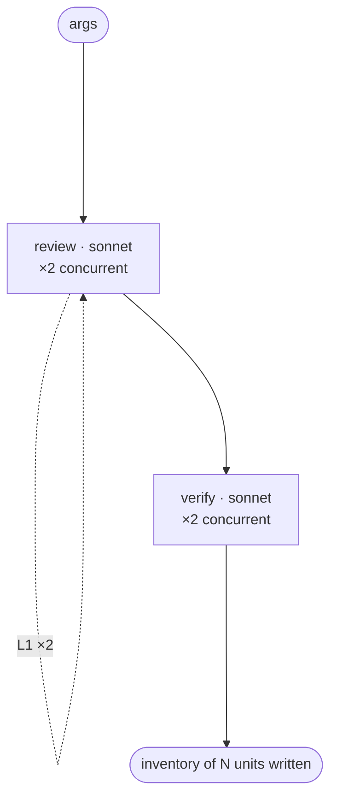

# fan flow map

Generated by `node tools/gen-flows.mjs fan`. **Do not hand-edit.**
Every node and edge below was *observed*: the scenarios in `tools/flows/` run the real engine
under the test harness with scripted agent returns, so this is what a run does rather than what
it might do. `node tools/gen-flows.mjs --check` fails the gate while this file is stale.

## Phases

| Phase | What happens |
|---|---|
| Review | Reviews each unit through each lens. |
| Verify | (not in meta.phases) |

## Loops

| Loop | Agent | Repeats while |
|---|---|---|
| L1 | review | both units are reviewed |

## Terminal states

| Terminal | Reached when | Source |
|---|---|---|
| inventory of N units written | both units are reviewed | declared |

## Coverage

1 scenarios · 2/2 roles · 0/0 throw sites · 0/0 halt statuses · 1 terminal states.
