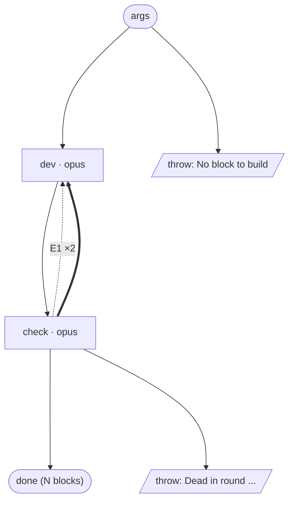

# seq flow map

Generated by `node tools/gen-flows.mjs seq`. **Do not hand-edit.**
Every node and edge below was *observed*: the scenarios in `tools/flows/` run the real engine
under the test harness with scripted agent returns, so this is what a run does rather than what
it might do. `node tools/gen-flows.mjs --check` fails the gate while this file is stale.

## Phases

| Phase | What happens |
|---|---|
| Dev | Builds one block. |
| Check | Checks one block. |

## Edges

| Edge | From | To | Taken when |
|---|---|---|---|
| E1 | check | dev | each check passes in round 2 |

The thick unlabelled edge of each pair above is the next-item advance (the unit boundary).

## Terminal states

| Terminal | Reached when | Source |
|---|---|---|
| done (N blocks) | each check passes in round 2 · each check passes in round 1 | derived |
| throw: No block to build | the args name no block | throw (line 12) |
| throw: Dead in round ... | the run dies in round 1 · the run dies in round 3 | throw (line 20) |

## Coverage

5 scenarios · 2/2 roles · 2/2 throw sites · 0/0 halt statuses · 3 terminal states.
